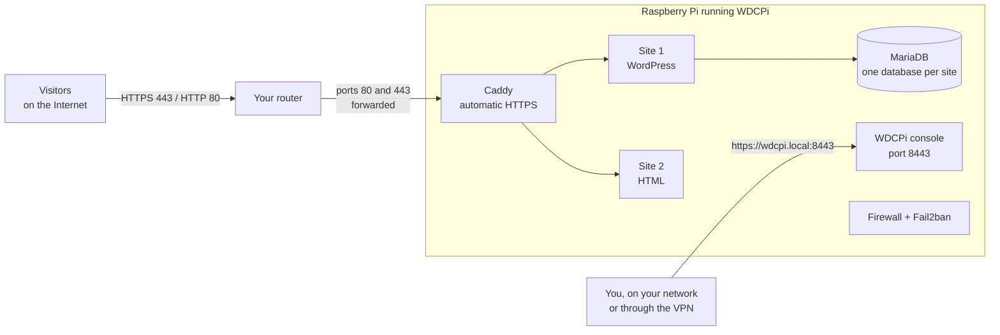

# WDCPi — WebDashboardController Pi

[🇫🇷 Français](README.md) · 🇬🇧 English

**WDCPi turns a Raspberry Pi into a secure web server, run from a simple web console.** You create websites
(WordPress, HTML pages, PHP) in a few clicks. The Pi then takes care of HTTPS certificates, security updates,
backups and protection against attacks on its own.

> The console's interface is in **French**. This guide gives every button name in French, followed by its
> English meaning, so you can find your way.

- **Websites**: WordPress, static site (HTML), PHP application, redirect, relay to a device at home, Docker
  application. Each site is isolated in its own container, with its own database.
- **Automatic HTTPS** (Let's Encrypt), renewed on its own.
- **Updates for everything**: system, kernel, Docker, site images, WordPress (core, plugins, themes), and the
  WDCPi console itself. They run at night, and security fixes are applied immediately. If a site stops
  answering after an update, it is rolled back automatically.
- **Security**:
  - a firewall where every change is "on trial" and reverts itself if it locks you out;
  - Fail2ban;
  - a console reachable only from your network or through the VPN;
  - system hardening.
- **Backups**: per site or full, on the Pi and on an encrypted USB key, with one-click restore.
- **Remote access**: WireGuard VPN (QR code for your phone), dynamic DNS for Infomaniak.
- **Monitoring**:
  - graphs;
  - e-mail alerts (disk, temperature, memory, backups);
  - visitor statistics without any tracker on your sites.
- **Simple mode** for every day, **expert mode** when you want to tune everything.

> WDCPi is free for **non-commercial** use (individuals, non-profits, schools…). Companies must ask for a
> licence: see [Licence](#licence).

---

## Contents

1. [How it works](#1-how-it-works)
2. [What you need](#2-what-you-need)
3. [Step-by-step installation on a Raspberry Pi](#3-step-by-step-installation-on-a-raspberry-pi)
4. [First settings in the console](#4-first-settings-in-the-console)
5. [Making the Pi reachable from the Internet](#5-making-the-pi-reachable-from-the-internet)
6. [Creating your first website](#6-creating-your-first-website)
7. [Day to day](#7-day-to-day)
8. [Installing on a server, a NAS or a Mac (VM)](#8-installing-on-a-server-a-nas-or-a-mac-vm)
9. [Security: what WDCPi does, what is up to you](#9-security-what-wdcpi-does-what-is-up-to-you)
10. [Troubleshooting](#10-troubleshooting)
11. [Licence](#licence)

---

## 1. How it works



- **Caddy** receives visitors, obtains and renews HTTPS certificates, and passes each request to the right site.
- **Each site** runs in its own Docker container (Apache or Nginx, PHP), in its folder `/www/<site>`. A hacked
  site cannot see the other sites, the rest of the Pi, or your home network.
- **MariaDB** hosts the databases. Each site has its own database and password, on an internal network of its own.
- **The WDCPi console** (port 8443) is where you run everything. It is **never** open to the Internet: only from
  your local network, or from outside through the VPN.
- **The firewall** blocks everything that is not planned. From the Internet, only the sites (80/443) can be
  reached, plus the VPN if you turn it on.
- **At night**, the Pi:
  1. installs updates;
  2. rebuilds the site images with the latest fixes;
  3. checks that every site answers, and rolls back the ones that don't;
  4. makes the scheduled backups (on Sundays by default);
  5. reboots if needed.

You log in to the console with the **Pi's Linux account** created during installation. Members of the `sudo`
group are administrators; other accounts can only look.

---

## 2. What you need

| Item | Recommended | Notes |
|---|---|---|
| Raspberry Pi | **Pi 5**, or a **Pi 4 with 2 GB of RAM or more** | Pi 3 and 1 GB Pi 4: fine for a small HTML site, too tight for WordPress |
| Storage | **32 GB or larger, A2-class** microSD card (well-known brand) | a USB SSD is more durable and faster |
| Power supply | the official one for your model | a weak power supply causes crashes |
| Network | an **Ethernet cable** to your router | Wi-Fi works, but a cable is more reliable for a server |
| Backups | a dedicated **USB key** (16 GB or more) | WDCPi encrypts it |
| A computer | Windows, macOS or Linux, with a card reader | to write the card with Raspberry Pi Imager |
| For the Internet | a **domain name** (e.g. `mysite.com`) and access to your router's settings | not needed for a site used only at home |

The first boot downloads about 1 GB, so an Internet connection is required.

---

## 3. Step-by-step installation on a Raspberry Pi

### Step 1: download WDCPi

From the [**Releases**](https://github.com/Trano89/WDCPi/releases/latest) page, download:

- `wdcpi-YYYY-MM-DD.img.xz`: the image to write to the card (about 700 MB);
- `wdcpi-imager.json`: the list for Raspberry Pi Imager, which gives you the customisation options;
- `SHA256SUMS`: the checksums, to check the download.

Checking the download is optional but recommended. In a terminal, in your downloads folder:

```bash
sha256sum -c SHA256SUMS --ignore-missing
```

On macOS: `shasum -a 256 -c SHA256SUMS --ignore-missing`. The result must say `OK`.

### Step 2: write the card with Raspberry Pi Imager

1. Install [Raspberry Pi Imager](https://www.raspberrypi.com/software/), version 2.0 or later.
2. Open Imager, then **App Options** → **Content Repository** → **Edit** → **Use custom file**, and pick
   `wdcpi-imager.json`. Imager asks for this file again each time it starts: this is normal.
3. Choose your Raspberry Pi **model**, then the **"WDCPi — serveur web"** system, then the **SD card**.
4. In the **customisation** step, set:
   - **Hostname**: for example `wdcpi`. The Pi will then be reachable as `wdcpi.local`.
   - **Username and password**: this account will be the console **administrator**. Use a long, unique password.
   - **Time zone and keyboard**.
   - **Wi-Fi**: only if you do not use a cable.
   - **SSH**: turn it on, preferably **with a public key** rather than a password.
5. Write the card, then eject it.

> **If Imager refuses the `.json` file**, choose "Use custom image" and pick the `.img.xz` file. The
> customisation step may then be missing. In that case the Pi asks you to create the account on screen at first
> boot, so you need a screen and a keyboard.

### Step 3: first boot (automatic, 5 to 15 minutes)

Put the card in the Pi, plug in the network cable, then the power. During the first boot, the Pi:

1. waits for the network and the exact time, and detects your local network;
2. sets up the firewall. Everything incoming is refused except:
   - the console and SSH, from your local network;
   - the sites (ports 80 and 443);
3. installs the WDCPi console, Caddy, MariaDB and Fail2ban. It creates the passwords and the certificate unique
   to **your** Pi (the image holds no secret);
4. wipes from the card the password left there by Imager, then restarts the services.

The log of this step is in `/var/log/wdcpi-premier-demarrage.log`.

### Step 4: find the Pi and open the console

From a computer on the **same network**, open **https://wdcpi.local:8443**. Replace `wdcpi` with the hostname
you chose.

If that name does not answer, find the Pi's IP address in your router's device list (for example `192.168.1.50`)
and open **https://192.168.1.50:8443**.

The browser shows a **security warning** the first time. This is normal: your Pi created the console's
certificate itself, and no public authority issued it. Choose "Advanced", then "Proceed". Check the address
carefully: only do this for **your** Pi, on **your** network.

Log in with the **username and password** chosen in Imager.

---

## 4. First settings in the console

Do these once, in this order:

1. **A fixed address for the Pi.** The best way is to reserve it in your router (a "static DHCP lease" or
   "address reservation"). Otherwise, use the console's **Réseau du Pi** (Pi network) page, in expert mode. Without a fixed
   address, port forwarding stops working the day the Pi's address changes.
2. **Notifications**, under **Réglages & système → Notifications** (Settings → Notifications): enter your e-mail address
   and a sending (SMTP) server, for example your e-mail provider's. Send a test e-mail. You will be told when the
   disk fills up, the Pi overheats, a backup is missing or an update fails.
3. **Certificate e-mail**, under **Services → Serveur web (Caddy) → Régler** (Services → Web server → Settings): Let's
   Encrypt writes to you if a certificate has a problem.
4. **Copy to a USB key**: backups are made automatically on the Pi (every Sunday by default, adjustable under **Réglages & système → Planifications**). To keep a copy elsewhere, plug in a USB key,
   open the **Stockage USB** (USB storage) page, then **Copier une sauvegarde ici** (copy a backup here). The copy is
   encrypted. After the first copy, open the **Sauvegardes** (Backups) page → **Afficher la phrase secrète** (show
   the passphrase): **write it down and keep it away from the Pi**, then confirm you have noted it. Without it,
   nobody can read a copy, neither you nor a thief.
5. **Updates**, under **Logiciels et mises à jour** (Software and updates): keep the defaults. Updates run
   automatically at night, security fixes are applied immediately, and the Pi reboots on its own when needed.

---

## 5. Making the Pi reachable from the Internet

Only needed if your sites must be visible outside your home.

### 5.1 Forward the router's ports

In your router's interface (the section is usually called "NAT", "Port forwarding" or "Virtual server"), create
two rules to the Pi's **fixed address**:

| External port | Protocol | To the Pi, port |
|---|---|---|
| 80 | TCP | 80 |
| 443 | TCP | 443 |

**Never** open port 8443 (console) or port 22 (SSH) to the Internet. To manage the Pi from outside, use the VPN
(section 7).

### 5.2 Point your domain name at the Pi

At your domain name provider (Infomaniak, OVH, Gandi, Cloudflare…), in the **DNS zone**:

| Type | Name | Value |
|---|---|---|
| A | `@` (the domain itself) | your **public IP address** |
| A | `www` | your **public IP address** |

The console shows your public IP address in the site creation wizard. Changes take from a few minutes to a few
hours to spread.

**Does your public IP address change from time to time?** Most home Internet plans do this.
- Domain at **Infomaniak**: turn on **dynamic DNS** in the console (VPN page → DNS dynamique). The Pi keeps the
  address up to date on its own.
- Other providers: use your router's DynDNS feature if it has one, or ask your Internet provider for a fixed
  address.

---

## 6. Creating your first website

### 6.1 A static site (HTML pages)

1. In the console, in **simple mode**, click **Créer un site** (Create a site).
2. **Type de site** (Site type): choose **Site à fichiers** (file-based site). You upload your HTML pages, images
   and styles, and they are published as they are.
3. **Adresse** (Address):
   - **Sur internet, avec mon nom de domaine** (On the Internet, with my domain name):
     - enter `mysite.com` and tick "Inclure aussi www.mysite.com" (also include www);
     - also tick "Pouvoir aussi l'ouvrir depuis mon réseau local" (also open it from my local network), so you can
       test before the domain is ready.
   - **Seulement sur mon réseau local** (Only on my local network): for testing or home use. The site opens at an
     address like `http://wdcpi.local:8081`.
4. **Vérification** (Review): check the details, then click **Créer le site** (Create the site). The console
   prepares the site and starts it.
5. On the site's page, click **Gérer les fichiers** (Manage files) and upload your home page `index.html`, your
   images and your styles. They go live immediately.
6. Open the site. **Ouvrir en local** (Open locally) works straight away. **Ouvrir le site** (Open the site) works
   once the domain points to the Pi.

### 6.2 A WordPress site

1. **Créer un site** → **WordPress** → **Sur internet, avec mon nom de domaine** → `mysite.com` → **Créer le
   site**. The database is created automatically, with a password unique to the site.
2. When the site shows **En ligne** (Online), click **Installer WordPress** (Install WordPress). WordPress's own
   wizard opens: choose the site title, your username and a strong password.
3. Your site is ready. The WordPress admin is at `https://mysite.com/wp-admin`. In the console, the **Protection
   de l'administration** (Admin protection) option can restrict it to your network.

WDCPi updates WordPress, its plugins and its themes every night, after backing up the database. If the site
stops answering, it is rolled back.

### 6.3 The HTTPS certificate

As long as the domain does not point to the Pi, the site's page shows "Connexion sécurisée (HTTPS) en attente"
(secure connection pending). As soon as DNS is right and ports 80/443 are forwarded, Caddy gets the certificate
on its own, usually in under a minute. It is then **renewed automatically**. If something goes wrong, the
**Certificats** (Certificates) page shows the exact error and what to fix.

### 6.4 Next steps

- **Sous-sites** (sub-sites): a blog at `blog.mysite.com` or `mysite.com/blog`.
- **Programme et composants** (Program and components):
  - turn an HTML site into a PHP or WordPress site;
  - change the PHP version;
  - add Redis.

  Each change shows a preview first, backs up the site, and rolls back automatically if it fails.
- **Redirection** (redirect an old domain to a new one) and **Relais vers un appareil** (relay to a device): for
  example, publish a camera or a NAS from home over HTTPS.

---

## 7. Day to day

| You want to… | Where, in the console |
|---|---|
| Check that all is well | **Tableau de bord** (Dashboard): site status, disk, temperature, latest backups |
| Back up or restore a site | site page → **Sauvegardes** (Backups), or the **Sauvegardes** page |
| See your visitors | site page → **Voir les visites et le journal** (Visits and log) |
| Update everything now | **Logiciels et mises à jour** → **Tout mettre à jour** (Update everything) |
| Manage the Pi from outside | **VPN** → WireGuard → add a device → scan the QR code with the WireGuard app. Then forward UDP port 51820 on your router to the Pi |
| Open a port or block an address | **Sécurité → Pare-feu** (Security → Firewall). A change you do not confirm within 2 minutes is undone on its own |
| Tune a service (MariaDB, time, logs) | **Services** |
| Add an account (read-only or administrator) | **Comptes** (Accounts) |

**WDCPi itself is updated** automatically from this GitHub repository. Every release is **signed**. The Pi checks
the signature before installing, keeps the previous version, and goes back to it on its own if the new one does
not answer.

---

## 8. Installing on a server, a NAS or a Mac (VM)

WDCPi also runs on **Debian 13** (recommended), **Debian 12** or **Ubuntu 24.04+**, on arm64 or amd64. This can
be:
- a mini-PC or a rented server;
- a virtual machine on a **Synology** NAS (Virtual Machine Manager);
- a VM on a **Mac** (UTM or OrbStack).

The console detects what the machine can do and only shows those features.

1. Install a minimal Debian 13 (no desktop) on the machine or VM, with an account that is a member of the
   `sudo` group.
2. Log in to the machine (over SSH or on its console), then run:

```bash
curl -fsSLO https://github.com/Trano89/WDCPi/releases/latest/download/installer.sh
sudo bash installer.sh
```

3. The installer downloads the latest WDCPi release, **checks its signature** before opening it, installs the
   packages, Docker, the console, the firewall and Fail2ban, then shows the console's address. From there, follow
   sections 4 to 7.

Notes:
- **Rented server on the Internet**: the installer refuses to treat a public network as a "local network". The
  console is then only reachable through the VPN, and SSH access from your current address is kept.
- **Synology**: use a **VM** (Virtual Machine Manager), not Container Manager. DSM already uses ports 80/443 there,
  and a firewall is not possible.
- **Mac**: the VM is mostly for testing. For a real server, use a Pi or a mini-PC that stays on all the time.

---

## 9. Security: what WDCPi does, what is up to you

**WDCPi takes care of:**
- applying security updates for everything installed, as soon as they are published;
- a firewall that is closed by default, Fail2ban against password guessing, and a console invisible from the
  Internet;
- isolating each site (its own container, database and network);
- encrypted backups.

**Up to you:**
- **long, unique passwords** (Pi account, WordPress), and preferably **SSH keys**;
- **two-factor authentication** on the WordPress admin (any plugin you like);
- keeping the USB key's **passphrase** away from the Pi, and taking a backup copy elsewhere from time to time. In
  case of theft or fire, the key plugged into the Pi disappears with it;
- installing only well-known, maintained WordPress plugins and themes;
- never opening ports 8443 or 22 on your router.

Found a vulnerability? Please do **not** post it in an issue. Report it privately through this repository's
**Security** tab ("Report a vulnerability").

---

## 10. Troubleshooting

| Problem | What to do |
|---|---|
| `wdcpi.local` does not answer | Use the Pi's IP address (router's device list). On first boot, wait 15 minutes |
| "Accès refusé" (access denied) on the console | You are not on the Pi's local network: join the same network, or use the VPN |
| No HTTPS certificate | **Certificats** page: check that the domain points to your public IP and that ports 80 and 443 are forwarded to the Pi |
| A site stops answering | Site page → **Redémarrer le site** (Restart the site). Otherwise look at the site's **Messages techniques** (technical messages), or restore the latest backup |
| The Pi is slow or crashes | Check the power supply and the temperature (dashboard). A USB SSD is better than an SD card |
| Forgotten account password | You need SSH access with a key, or a screen and keyboard; then change the password with `passwd` |
| Moving to a new Debian release | Write the new WDCPi image to **another** card, then restore your full backup (**Sauvegardes → Importer une sauvegarde**, Import a backup). The old card stays as your fallback |

To report a problem, use the [**Issues**](https://github.com/Trano89/WDCPi/issues) tab. Give your Pi model, the
WDCPi version (bottom of the left menu) and what you see on screen. Never post a password.

---

## Licence

WDCPi is distributed under the **[PolyForm Strict License 1.0.0](LICENSE.md)**:

- ✅ **free** for any **non-commercial** use: individuals, hobbies, study, non-profits, schools, public bodies;
- ❌ **no commercial use** without a licence: a company, a freelancer, or any use to earn money must ask for a
  commercial licence (open an issue titled "Commercial license");
- ❌ **no redistribution** and no modified versions.

The licence text in [LICENSE.md](LICENSE.md) is the one that applies; this summary only explains it.

WDCPi relies on free software, each keeping its own licence: Raspberry Pi OS / Debian, Docker, Caddy, MariaDB,
WordPress, PHP, Fail2ban, WireGuard, etc. See [COMPOSANTS-TIERS.md](COMPOSANTS-TIERS.md).

*Raspberry Pi is a trademark of Raspberry Pi Ltd. WDCPi is an independent project, not affiliated with Raspberry Pi Ltd.*
