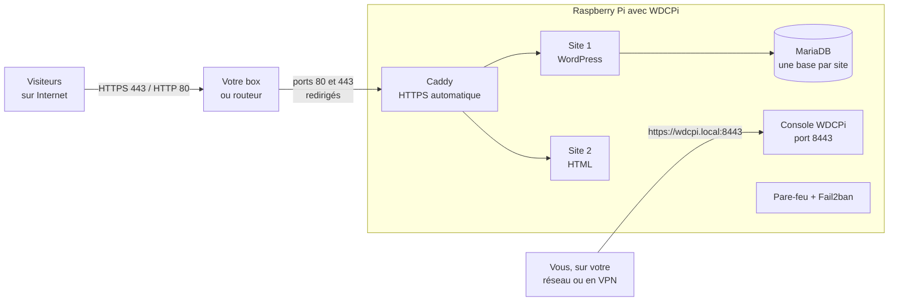

# WDCPi — WebDashboardController Pi

🇫🇷 Français · [🇬🇧 English](README.en.md)

**WDCPi transforme un Raspberry Pi en serveur web sécurisé, piloté depuis une console web simple, en français.**
Vous y créez vos sites (WordPress, pages HTML, PHP) en quelques clics. Le Pi s'occupe tout seul des certificats
HTTPS, des mises à jour de sécurité, des sauvegardes et de la protection contre les attaques.

- **Sites web** : WordPress, site à fichiers (HTML), application PHP, redirection, relais vers un appareil de la
  maison, application Docker. Chaque site est isolé dans son propre conteneur, avec sa base de données.
- **HTTPS automatique** (Let's Encrypt), renouvelé tout seul.
- **Mises à jour de tout** : système, noyau, Docker, images des sites, WordPress (cœur, extensions, thèmes), et la
  console WDCPi elle-même. La nuit, et immédiatement pour les correctifs de sécurité, avec retour en arrière
  automatique si un site ne répond plus.
- **Sécurité** : pare-feu (chaque changement est « à l'essai » et s'annule seul s'il vous coupe l'accès),
  Fail2ban, console accessible seulement depuis votre réseau ou par VPN, durcissement du système.
- **Sauvegardes** : par site ou complètes, sur le Pi et sur une clé USB chiffrée, restauration en un clic.
- **Accès à distance** : VPN WireGuard (QR code pour le téléphone), DNS dynamique Infomaniak.
- **Surveillance** : graphiques, alertes par e-mail (disque, température, mémoire, sauvegardes), statistiques de
  visites sans aucun traceur sur vos sites.
- **Mode simple** pour tous les jours, **mode expert** quand vous voulez tout régler.

> WDCPi est gratuit pour un usage **non commercial** (particuliers, associations, écoles…). Une entreprise doit
> demander une licence : voir [Licence](#licence).

---

## Sommaire

1. [Comment ça marche](#1-comment-ça-marche)
2. [Ce qu'il vous faut](#2-ce-quil-vous-faut)
3. [Installation pas à pas sur un Raspberry Pi](#3-installation-pas-à-pas-sur-un-raspberry-pi)
4. [Premiers réglages dans la console](#4-premiers-réglages-dans-la-console)
5. [Rendre le Pi joignable depuis Internet](#5-rendre-le-pi-joignable-depuis-internet)
6. [Créer votre premier site web](#6-créer-votre-premier-site-web)
7. [Au quotidien](#7-au-quotidien)
8. [Installer sur un serveur, un NAS ou un Mac (VM)](#8-installer-sur-un-serveur-un-nas-ou-un-mac-vm)
9. [Sécurité : ce que WDCPi fait, ce qui reste à vous](#9-sécurité--ce-que-wdcpi-fait-ce-qui-reste-à-vous)
10. [Dépannage](#10-dépannage)
11. [Licence](#licence)

---

## 1. Comment ça marche



- **Caddy** reçoit les visiteurs, obtient et renouvelle les certificats HTTPS, et transmet chaque demande au bon
  site.
- **Chaque site** tourne dans son propre conteneur Docker (Apache ou Nginx, PHP), dans son dossier `/www/<site>`.
  Un site piraté ne voit ni les autres sites, ni le reste du Pi, ni votre réseau local.
- **MariaDB** héberge les bases de données. Chaque site a sa base et son mot de passe, sur un réseau interne
  propre au site.
- **La console WDCPi** (port 8443) sert à tout piloter. Elle n'est **jamais** ouverte sur Internet : seulement
  depuis votre réseau local, ou depuis l'extérieur par le VPN.
- **Le pare-feu** refuse tout ce qui n'est pas prévu. Seuls les sites (80/443) et, si vous l'activez, le VPN sont
  joignables depuis Internet.
- **La nuit**, le Pi installe les mises à jour, reconstruit les images des sites avec les derniers correctifs,
  vérifie que chaque site répond, revient en arrière sinon, fait les sauvegardes prévues (le dimanche par défaut), puis redémarre si besoin.

Vous vous connectez à la console avec le **compte Linux du Pi** créé à l'installation. Les membres du groupe
`sudo` sont administrateurs ; les autres comptes peuvent seulement consulter.

---

## 2. Ce qu'il vous faut

| Élément | Recommandé | Remarques |
|---|---|---|
| Raspberry Pi | **Pi 5** ou **Pi 4 avec 2 Go de RAM ou plus** | Pi 3 et Pi 4 1 Go : possible pour un petit site HTML, trop juste pour WordPress |
| Stockage | carte microSD **32 Go ou plus, classe A2** (marque connue) | un SSD USB est plus durable et plus rapide |
| Alimentation | l'alimentation officielle du modèle | une alimentation faible provoque des plantages |
| Réseau | **câble Ethernet** vers la box | le Wi-Fi fonctionne, mais le câble est plus fiable pour un serveur |
| Sauvegardes | une **clé USB** dédiée (16 Go ou plus) | elle sera chiffrée par WDCPi |
| Un ordinateur | Windows, macOS ou Linux, avec un lecteur de carte | pour graver la carte avec Raspberry Pi Imager |
| Pour Internet | un **nom de domaine** (ex. `monsite.ch`) et l'accès aux réglages de votre box | pas nécessaire pour un site visible seulement à la maison |

Le premier démarrage télécharge environ 1 Go : une connexion Internet est nécessaire.

---

## 3. Installation pas à pas sur un Raspberry Pi

### Étape 1 : télécharger WDCPi

Sur la page [**Releases**](https://github.com/Trano89/WDCPi/releases/latest), téléchargez :

- `wdcpi-AAAA-MM-JJ.img.xz` : l'image à graver (environ 700 Mo) ;
- `wdcpi-imager.json` : la liste pour Raspberry Pi Imager (pour avoir la personnalisation) ;
- `SHA256SUMS` : les empreintes, pour vérifier le téléchargement.

Vérification (facultative mais conseillée), dans un terminal, dans le dossier des téléchargements :

```bash
sha256sum -c SHA256SUMS --ignore-missing
```

Sur macOS : `shasum -a 256 -c SHA256SUMS --ignore-missing`. Le résultat doit dire `OK`.

### Étape 2 : graver la carte avec Raspberry Pi Imager

1. Installez [Raspberry Pi Imager](https://www.raspberrypi.com/software/) (version 2.0 ou plus récente).
2. Ouvrez Imager → **Options de l'application** → **Dépôt de contenu** → **Modifier** →
   **Utiliser un fichier personnalisé** → choisissez `wdcpi-imager.json`.
   Imager redemande ce fichier à chaque lancement : c'est normal.
3. Choisissez votre **modèle** de Raspberry Pi, puis le système **« WDCPi — serveur web »**, puis la **carte SD**.
4. Dans la **personnalisation**, réglez :
   - **Nom d'hôte** : par exemple `wdcpi`. Le Pi sera joignable à l'adresse `wdcpi.local` ;
   - **Compte et mot de passe** : ce compte sera **administrateur** de la console. Choisissez un mot de passe long
     et unique ;
   - **Fuseau horaire et clavier** ;
   - **Wi-Fi** : seulement si vous n'utilisez pas de câble ;
   - **SSH** : activez-le, de préférence **avec une clé publique** plutôt qu'un mot de passe.
5. Lancez l'écriture, puis éjectez la carte.

> **Si Imager refuse le fichier `.json`** : choisissez « Utiliser une image personnalisée » et prenez le fichier
> `.img.xz`. La personnalisation peut alors manquer : au premier démarrage, le Pi demandera de créer le compte à
> l'écran (il faut un écran et un clavier).

### Étape 3 : premier démarrage (automatique, 5 à 15 minutes)

Mettez la carte dans le Pi, branchez le câble réseau, puis l'alimentation. Pendant le premier démarrage, le Pi :

1. attend le réseau et l'heure exacte, puis détecte votre réseau local ;
2. règle le pare-feu : tout est refusé en entrée, sauf la console et SSH depuis votre réseau local, et les sites
   (ports 80 et 443) ;
3. installe la console WDCPi, Caddy, MariaDB et Fail2ban, et crée les mots de passe et le certificat propres à
   **votre** Pi (l'image ne contient aucun secret) ;
4. efface de la carte le mot de passe laissé par Imager, puis redémarre les services.

Le journal de cette étape est dans `/var/log/wdcpi-premier-demarrage.log`.

### Étape 4 : trouver le Pi et ouvrir la console

Depuis un ordinateur **du même réseau**, ouvrez **https://wdcpi.local:8443** (remplacez `wdcpi` par le nom
d'hôte choisi).

Si ce nom ne répond pas, trouvez l'adresse IP du Pi dans la liste des appareils de votre box (par exemple
`192.168.1.50`) et ouvrez **https://192.168.1.50:8443**.

Le navigateur affiche un **avertissement de sécurité** : c'est normal la première fois. Le certificat de la
console est créé par votre Pi lui-même, et non par une autorité publique. Choisissez « Avancé » puis « Continuer
vers le site ». Vérifiez bien l'adresse : ne le faites que pour **votre** Pi, sur **votre** réseau.

Connectez-vous avec le **compte et le mot de passe** choisis dans Imager.

---

## 4. Premiers réglages dans la console

Dans cet ordre, une seule fois :

1. **Adresse fixe du Pi.** Le mieux est de la réserver dans votre box (« bail DHCP statique » ou « réservation
   d'adresse »). Sinon : page **Réseau du Pi** de la console (mode expert). Sans adresse fixe, la redirection des ports de la
   box cessera de fonctionner le jour où l'adresse change.
2. **Notifications** (**Réglages & système → Notifications**) : votre adresse e-mail et un serveur d'envoi (SMTP), par
   exemple celui de votre fournisseur de messagerie. Envoyez un e-mail d'essai. Vous serez prévenu si le disque se
   remplit, si le Pi chauffe, si une sauvegarde manque ou si une mise à jour échoue.
3. **E-mail des certificats** (**Services → Serveur web (Caddy) → Régler**) : Let's Encrypt vous écrit si un certificat
   pose problème.
4. **Copie sur clé USB** : les sauvegardes sont faites automatiquement sur le Pi (chaque dimanche par défaut, réglable dans **Réglages & système → Planifications**). Pour en garder une copie à part,
   branchez une clé USB, ouvrez la page **Stockage USB**, puis **Copier une sauvegarde ici**. La copie est chiffrée.
   Après la première copie, ouvrez la page **Sauvegardes** → **Afficher la phrase secrète** : **notez-la et
   rangez-la hors du Pi**, puis confirmez qu'elle est notée. Sans elle, une copie ne peut pas être relue, ni par
   vous ni par un voleur.
5. **Mises à jour** (**Logiciels et mises à jour**) : laissez les réglages par défaut (automatiques la nuit,
   correctifs de sécurité immédiats, redémarrage automatique si nécessaire).

---

## 5. Rendre le Pi joignable depuis Internet

À faire seulement si vos sites doivent être visibles hors de chez vous.

### 5.1 Rediriger les ports de la box

Dans l'interface de votre box ou de votre routeur (rubrique « NAT », « Redirection de ports » ou « Port
forwarding »), créez deux règles vers l'**adresse fixe du Pi** :

| Port externe | Protocole | Vers le Pi, port |
|---|---|---|
| 80 | TCP | 80 |
| 443 | TCP | 443 |

**N'ouvrez jamais** le port 8443 (console) ni le port 22 (SSH) sur Internet. Pour administrer le Pi depuis
l'extérieur, utilisez le VPN (section 7).

### 5.2 Faire pointer votre nom de domaine vers le Pi

Chez le fournisseur de votre nom de domaine (Infomaniak, OVH, Gandi…), dans la **zone DNS** :

| Type | Nom | Valeur |
|---|---|---|
| A | `@` (le domaine lui-même) | votre **adresse IP publique** |
| A | `www` | votre **adresse IP publique** |

La console affiche votre adresse IP publique dans l'assistant de création de site. La propagation prend de
quelques minutes à quelques heures.

**Votre adresse IP publique change de temps en temps ?** C'est le cas de la plupart des abonnements privés.
- Domaine chez **Infomaniak** : activez le **DNS dynamique** dans la console (page VPN → DNS dynamique). Le Pi met
  l'adresse à jour tout seul.
- Autre fournisseur : utilisez la fonction DynDNS de votre box si elle en a une, ou demandez une adresse fixe à
  votre fournisseur d'accès.

---

## 6. Créer votre premier site web

### 6.1 Un site à fichiers (pages HTML)

1. Dans la console, en **mode simple**, cliquez sur **Créer un site**.
2. **Type de site** : choisissez **Site à fichiers** (« Vous déposez vos pages HTML, images et styles : ils sont
   publiés tels quels »).
3. **Adresse** :
   - **Sur internet, avec mon nom de domaine** : saisissez `monsite.ch`, et cochez « Inclure aussi
     www.monsite.ch ». Cochez aussi « Pouvoir aussi l'ouvrir depuis mon réseau local » : vous pourrez tester avant
     que le domaine soit prêt.
   - **Seulement sur mon réseau local** : pour essayer, ou pour un usage à la maison. Le site s'ouvrira à une
     adresse du type `http://wdcpi.local:8081`.
4. **Vérification** : relisez, puis cliquez sur **Créer le site**. La console prépare le site et le démarre.
5. Sur la page du site, cliquez sur **Gérer les fichiers** et envoyez votre page d'accueil `index.html`, vos images
   et vos styles. Ils sont publiés immédiatement.
6. Ouvrez le site : avec **Ouvrir en local** tout de suite, ou avec **Ouvrir le site** une fois le domaine pointé.

### 6.2 Un site WordPress

1. **Créer un site** → **WordPress** → **Sur internet, avec mon nom de domaine** → `monsite.ch` → **Créer le
   site**. La base de données est créée automatiquement, avec un mot de passe propre au site.
2. Quand le site est **En ligne**, cliquez sur **Installer WordPress**. L'assistant de WordPress s'ouvre :
   choisissez le titre du site, votre identifiant et un mot de passe solide.
3. Votre site est prêt. L'administration WordPress est à `https://monsite.ch/wp-admin`. Dans la console,
   l'option **Protection de l'administration** peut la réserver à votre réseau.

WDCPi met à jour WordPress, ses extensions et ses thèmes chaque nuit, après une sauvegarde de la base, avec retour
en arrière si le site ne répond plus.

### 6.3 Le certificat HTTPS

Tant que le domaine ne pointe pas vers le Pi, la page du site indique « Connexion sécurisée (HTTPS) en attente ».
Dès que le DNS est correct et les ports 80/443 redirigés, Caddy obtient le certificat tout seul, en général en
moins d'une minute. Il est ensuite **renouvelé automatiquement**. En cas de problème, la page **Certificats** donne
l'erreur exacte et ce qu'il faut corriger.

### 6.4 Et ensuite

- **Sous-sites** : un blog en `blog.monsite.ch` ou en `monsite.ch/blog`.
- **Programme et composants** : passer un site HTML en PHP ou en WordPress, changer la version de PHP, ajouter
  Redis. Avec aperçu, sauvegarde avant et retour automatique.
- **Redirection** (ancien domaine vers le nouveau) et **Relais vers un appareil** (par exemple une caméra ou un NAS
  de la maison, publié en HTTPS).

---

## 7. Au quotidien

| Vous voulez… | Où, dans la console |
|---|---|
| Voir si tout va bien | **Tableau de bord** : état des sites, disque, température, dernières sauvegardes |
| Sauvegarder ou restaurer un site | page du site → **Sauvegardes**, ou page **Sauvegardes** |
| Voir les visites | page du site → **Voir les visites et le journal** |
| Tout mettre à jour maintenant | **Logiciels et mises à jour** → **Tout mettre à jour** |
| Administrer depuis l'extérieur | **VPN** → WireGuard → ajouter un appareil → scanner le QR code avec l'application WireGuard. Redirigez alors le port UDP 51820 de la box vers le Pi |
| Ouvrir un port, bloquer une adresse | **Sécurité → Pare-feu** : chaque changement s'annule seul après 2 minutes si vous ne le confirmez pas |
| Régler un service (MariaDB, heure, journaux) | **Services** |
| Ajouter un compte (lecture seule ou administrateur) | **Comptes** |

La **mise à jour de WDCPi** elle-même arrive automatiquement depuis ce dépôt GitHub. Chaque version est **signée** ;
le Pi vérifie la signature avant d'installer, garde l'ancienne version et y revient seul si la nouvelle ne répond
pas.

---

## 8. Installer sur un serveur, un NAS ou un Mac (VM)

WDCPi fonctionne aussi sur **Debian 13** (recommandé), **Debian 12** ou **Ubuntu 24.04+**, en arm64 ou amd64 : un
mini-PC, un serveur loué, une machine virtuelle sur un NAS **Synology** (Virtual Machine Manager), ou une VM sur
un **Mac** (UTM ou OrbStack). La console détecte ce que la machine sait faire et n'affiche que ces fonctions.

1. Installez Debian 13 (version minimale, sans bureau) dans la machine ou la VM, avec un compte membre du groupe
   `sudo`.
2. Connectez-vous à la machine (en SSH ou sur sa console), puis lancez :

```bash
curl -fsSLO https://github.com/Trano89/WDCPi/releases/latest/download/installer.sh
sudo bash installer.sh
```

3. L'installateur télécharge la dernière version de WDCPi, **vérifie sa signature** avant de l'ouvrir, installe les
   paquets, Docker, la console, le pare-feu et Fail2ban, puis affiche l'adresse de la console. La suite est
   identique : sections 4 à 7.

Remarques :
- **Serveur loué sur Internet** : l'installateur refuse de considérer un réseau public comme « réseau local » ; la
  console n'y est alors joignable que par le VPN, et l'accès SSH depuis votre adresse actuelle est conservé.
- **Synology** : utilisez une **VM** (Virtual Machine Manager), pas Container Manager, car les ports 80/443 y sont
  pris par DSM et le pare-feu n'y est pas possible.
- **Mac** : la VM sert surtout aux essais. Pour un vrai serveur, préférez un Pi ou un mini-PC allumé en permanence.

---

## 9. Sécurité : ce que WDCPi fait, ce qui reste à vous

**WDCPi s'en occupe :**
- les mises à jour de sécurité de tout ce qui est installé, appliquées dès leur publication ;
- un pare-feu fermé par défaut, Fail2ban contre les essais de mots de passe, une console invisible depuis Internet ;
- l'isolement de chaque site (conteneur, base de données et réseau propres) ;
- des sauvegardes chiffrées.

**C'est à vous :**
- des **mots de passe longs et uniques** (compte du Pi, WordPress), et de préférence **SSH par clé** ;
- la **double authentification** sur l'administration WordPress (extension de votre choix) ;
- garder la **phrase secrète** de la clé USB hors du Pi, et emporter de temps en temps une copie de sauvegarde
  ailleurs (en cas de vol ou d'incendie, la clé branchée sur le Pi disparaît avec lui) ;
- n'installer dans WordPress que des extensions et thèmes connus et maintenus ;
- ne jamais ouvrir les ports 8443 ou 22 de votre box.

Vous avez trouvé une faille ? Merci de **ne pas** la publier dans une « issue » : écrivez-nous en privé via
l'onglet **Security** de ce dépôt (« Report a vulnerability »).

---

## 10. Dépannage

| Problème | Que faire |
|---|---|
| `wdcpi.local` ne répond pas | Utilisez l'adresse IP du Pi (liste des appareils de la box). Attendez 15 minutes au premier démarrage |
| « Accès refusé » à la console | Vous n'êtes pas sur le réseau local du Pi : connectez-vous au même réseau, ou passez par le VPN |
| Le certificat HTTPS ne vient pas | Page **Certificats** : vérifiez que le domaine pointe vers votre IP publique et que les ports 80 et 443 sont redirigés vers le Pi |
| Un site ne répond plus | Page du site → **Redémarrer le site**. Sinon, **Messages techniques** du site, ou restaurez la dernière sauvegarde |
| Le Pi est lent ou plante | Vérifiez l'alimentation et la température (tableau de bord). Préférez un SSD USB à la carte SD |
| Mot de passe du compte oublié | Il faut un accès SSH par clé, ou brancher écran et clavier, puis changer le mot de passe avec `passwd` |
| Passer à une nouvelle version de Debian | Gravez la nouvelle image WDCPi sur une **autre** carte, puis restaurez votre sauvegarde complète (**Sauvegardes → Importer une sauvegarde**). L'ancienne carte reste votre solution de repli |

Pour signaler un problème : onglet [**Issues**](https://github.com/Trano89/WDCPi/issues). Indiquez votre modèle de Pi,
la version de WDCPi (en bas du menu, à gauche) et ce qui s'affiche. N'y mettez jamais de mot de passe.

---

## Licence

WDCPi est distribué sous la **[PolyForm Strict License 1.0.0](LICENSE.md)** :

- ✅ **gratuit** pour tout usage **non commercial** : particuliers, loisirs, études, associations, écoles,
  organismes publics ;
- ❌ **pas d'usage commercial** sans licence : une entreprise, un indépendant ou un usage pour gagner de l'argent
  doit demander une licence commerciale (ouvrez une issue « Licence commerciale ») ;
- ❌ **pas de redistribution** ni de version modifiée.

Seul le texte anglais de la licence fait foi ; ce résumé n'en est qu'une explication.

WDCPi s'appuie sur des logiciels libres qui gardent chacun leur propre licence : Raspberry Pi OS / Debian, Docker,
Caddy, MariaDB, WordPress, PHP, Fail2ban, WireGuard, etc. Voir [COMPOSANTS-TIERS.md](COMPOSANTS-TIERS.md).

*Raspberry Pi est une marque de Raspberry Pi Ltd. WDCPi est un projet indépendant, sans lien avec Raspberry Pi Ltd.*
